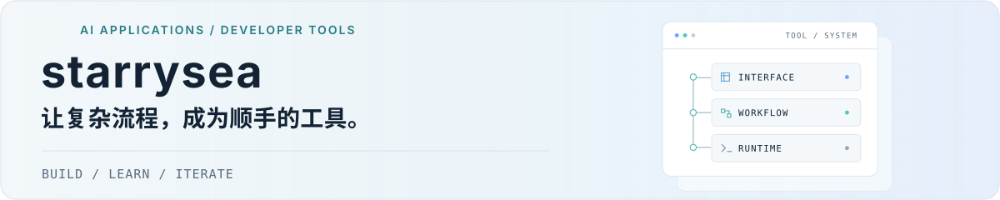
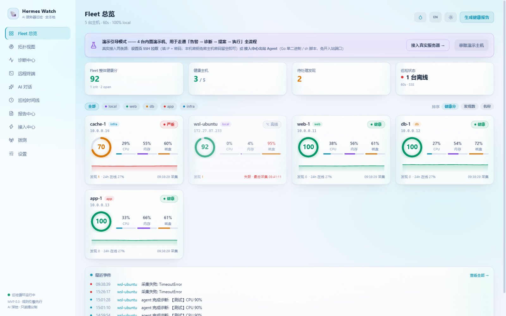
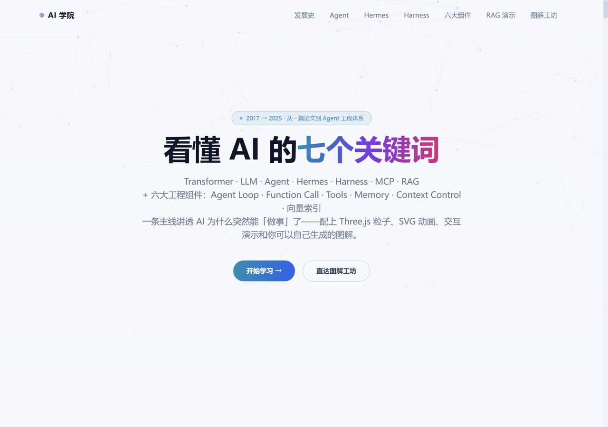
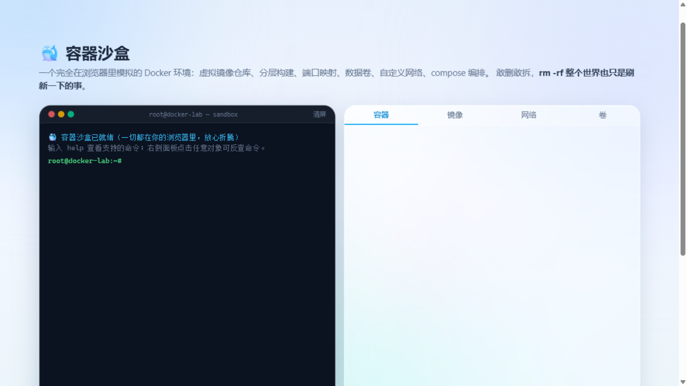
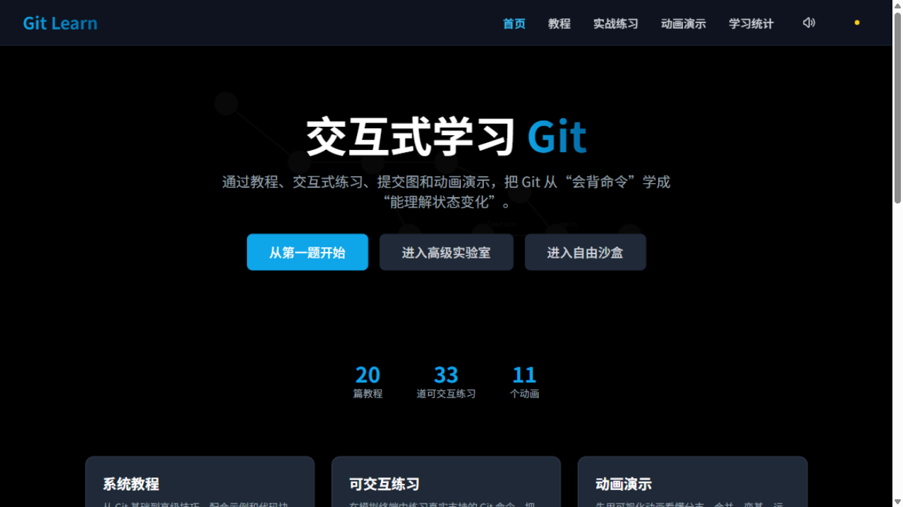
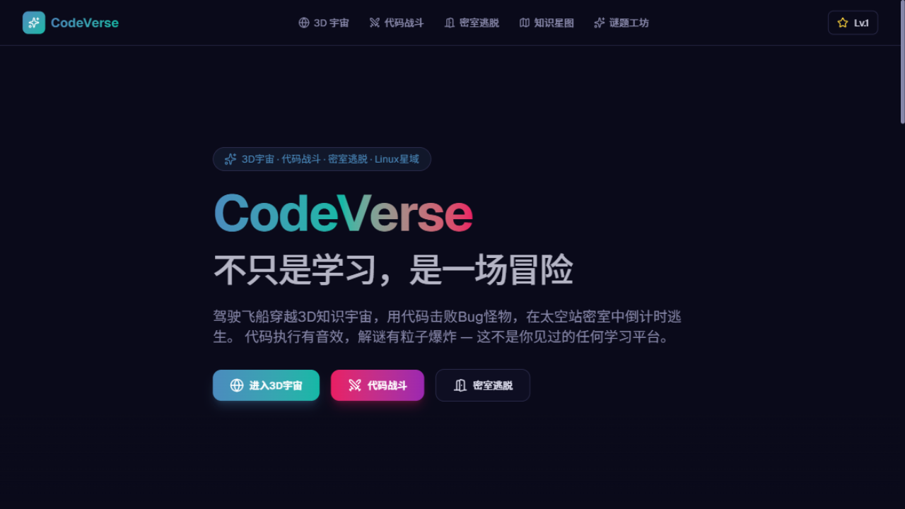
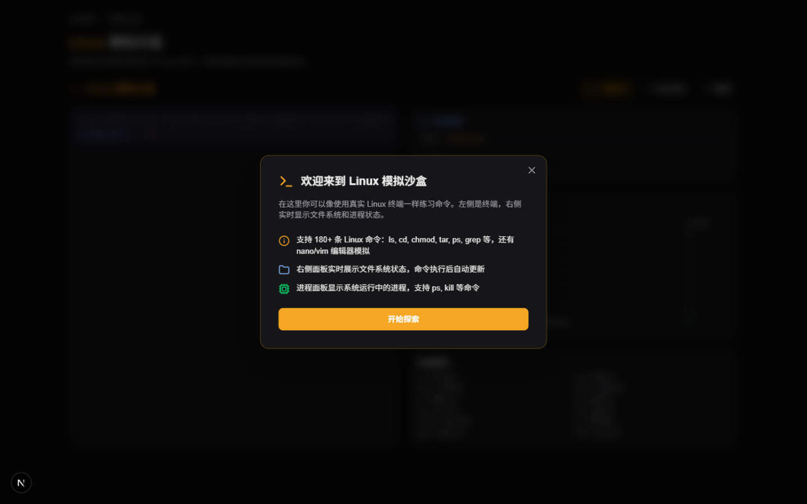

<picture>
  <source media="(max-width: 600px)" srcset="assets/banner-mobile.svg" />
  
</picture>

做 **AI 应用与开发者工具**，也把技术原理做成可以操作的交互作品。

[GitHub](https://github.com/StarrySea1412) · [Gitee](https://gitee.com/starry-sea-1412)

## 代表项目

- **[Hermes Agent Workbench](https://github.com/StarrySea1412/hermes-agent-workbench)** — 基于 Hermes 的本地 Agent 工作台，整合会话、工具调用与文档操作，为特定受控工具提供审批、取消与超时处理。
- **[Easel · 二次开发](https://github.com/StarrySea1412/Easel)** — 基于 [ZJU-REAL/Easel](https://github.com/ZJU-REAL/Easel)，个人改动聚焦执行回执、会话状态隔离与网关恢复；保留 Apache-2.0 上游署名。
- **[Hermes Watch](https://github.com/StarrySea1412/hermes-watch)** — 服务器巡检与运维工作台，串联采集、规则、告警、拨测与受控执行，模型可补充诊断说明。
- **[SmartGalleryAI](https://github.com/StarrySea1412/SmartGalleryAI)** — 本地图片管理与 OCR 全文搜索 MVP，包含扫描去重、缩略图生成与分析状态管理。

## 项目与交互作品预览

<table>
  <tr>
    <td width="50%" valign="top">
      
      <b><a href="https://github.com/StarrySea1412/hermes-watch">Hermes Watch</a></b> 
      巡检总览、告警与诊断（演示模式界面）
    </td>
    <td width="50%" valign="top">
      
      <b><a href="https://github.com/StarrySea1412/ai-learning-platform">AI 学习平台</a></b> 
      用交互演示理解 LLM、Agent、MCP 与 RAG
    </td>
  </tr>
  <tr>
    <td width="50%" valign="top">
      
      <b><a href="https://github.com/StarrySea1412/container-learning-platform">容器学习平台</a></b> 
      Docker / Kubernetes 课程与浏览器模拟沙盒
    </td>
    <td width="50%" valign="top">
      
      <b><a href="https://github.com/StarrySea1412/git-learning-platform">Git 学习平台</a></b> 
      提交图、分支协作与合并冲突练习
    </td>
  </tr>
  <tr>
    <td width="50%" valign="top">
      
      <b><a href="https://gitee.com/starry-sea-1412/python-learning">Python 学习平台</a></b> 
      浏览器内课程、代码运行与练习
    </td>
    <td width="50%" valign="top">
      
      <b><a href="https://gitee.com/starry-sea-1412/linux-learning-platform">Linux 学习平台</a></b> 
      命令学习与文件系统模拟终端
    </td>
  </tr>
</table>

## Agent 工程笔记

把运行时、记忆、评测和工具设计写成文章，配上可操作的小样。

[运行时](https://github.com/StarrySea1412/agent-kernel) · [记忆](https://github.com/StarrySea1412/agent-memory) · [评测](https://github.com/StarrySea1412/agent-eval) · [工具设计](https://github.com/StarrySea1412/agent-design) · [通信](https://github.com/StarrySea1412/agent-signals) · [技能](https://github.com/StarrySea1412/agent-skillcraft) · [编排](https://github.com/StarrySea1412/agent-orchestrator) · [路由](https://github.com/StarrySea1412/agent-switchboard) · [巡检](https://github.com/StarrySea1412/agent-patrol)

## 更多工具与作品

[ProjectPilot / Seewrok](https://github.com/StarrySea1412/utools-project-pilot)（本地项目与 Git 工作台） · [ClipMaster](https://github.com/StarrySea1412/clipmaster)（桌面剪贴板管理器） · [摄影学习平台](https://gitee.com/starry-sea-1412/photography-learning)（曝光与摄影交互练习）

## 技术栈

  <picture>
    <source media="(prefers-color-scheme: dark)" srcset="https://skillicons.dev/icons?i=ts,react,nextjs,python,fastapi,tailwind,docker,git&amp;theme=dark" />
    
  </picture>

## GitHub 贡献记录

<picture>
  <source media="(prefers-color-scheme: dark)" srcset="https://raw.githubusercontent.com/StarrySea1412/StarrySea1412/output/github-contribution-grid-snake-dark.svg" />
  
</picture>

---

关注 AI 应用、前端与桌面工具开发机会。欢迎通过项目 Issue 交流。

